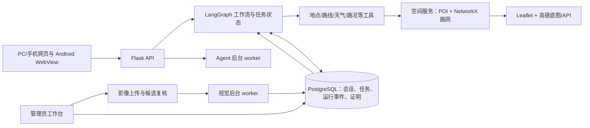

# 珞珈智行（WHU-Walker）项目全量交接

> 更新日期：2026-10-19（Asia/Shanghai）  
> 用途：交接当前项目目标、系统组成、已完成工作、验收证据和下一步。本文依据本机独立 worktree、项目文档和本轮验收记录整理；不代表最新生产环境巡检，也不把软件集成测试写成现场或论文效果。

## 一页结论

珞珈智行是面向武汉大学校园的时空智能体。用户用自然语言描述目的地、活动、途经点、出行方式和路线偏好；系统补问必要信息、调用地点与路网工具、生成和核验路线，再用地图及分段说明反馈。管理者可维护道路事件并复核航拍影像候选；确认后的有效事件可用于回答路况问题和重算路线。

本轮主要完成的是 **Agent 输入输出链路和 POI 推荐工程验收**：6 个起点覆盖三个学部、22 类活动，共 132 组结果；独立网络距离核对通过 44/44。工具轨迹现能从浏览器请求经过 Flask、Agent worker 写入隔离 PostgreSQL；隐私字段测试通过 1/1。它们证明代码和数据链路按预期工作，**不证明地点入口、道路现场通行或 Agent 判断准确率**。

当前项目尚不具备可报告的正式盲测成绩。60 个开发场景、72 轮对话仍待独立人工裁决；冻结盲测集为 0 条。校园道路的关键路线证据、Android 真机和校园无人机识别效果也未完成。当前独立工作树没有提交、推送或部署。

## 1. 项目定位与研究主线

### 产品定位

它不是单纯的聊天机器人，也不是只把 POI 名字交给地图导航。Agent 负责理解和澄清任务，空间工具负责地点筛选、路网计算和通行约束，验证层检查工具结果，持久化状态支持多轮续接和管理端事件联动。

面向论文的候选主线是：在校园复合空间任务中，检验 **情境与任务状态关联、路线执行结果核验、环境变化后的路线更新** 是否能提升任务完成质量并减少无效重复执行。该主线仍须由导师确认，当前正式对照实验尚未开始计分。

### 核心原则

- 保留 OSM、校方课程/空间数据和高德底图/API 的混合架构；不同来源有不同的坐标、许可和质量边界。
- 内部路网计算与外部底图显示需遵循项目的坐标转换边界；坐标系转换本身不能补路、校正错误几何或证明道路可通行。
- 最短路线按纯距离策略运行；用户偏好、硬约束、路况事件和地图展示应由明确状态传递，不能靠模型回答“猜”路线结果。
- 关键路线抽样核验即可支持有范围的研究主张，不要求本科生逐条测量全校道路；未核实的入口与连接要标为未知。
- 无人机识别候选须经过管理者复核后才能成为有效道路事件。当前事故、积水及校园拥堵效果没有校园独立航次证据。

## 2. 系统结构



| 层 | 主要目录/文件 | 作用与交接说明 |
|---|---|---|
| Web 服务 | `app.py`、`api/` | Flask 入口、用户会话/任务/路线接口、管理端接口。路由蓝图需和前端请求一起检查。 |
| Agent | `agents/workflow.py`、`planner.py`、`parser.py`、`state_models.py`、`task_planner.py`、`context_builder.py` | LangGraph 编排、需求解析、任务状态、工具执行及回答组织。`agents/tools.py` 是工具 schema 和执行入口；修改 schema 时同步校验提示词和前端结果消费。 |
| 空间数据与路由 | `data/`、`spatial/` | `data/pois.json` 是地点主库；`data/whu_road_network.graphml` 是路网；校方课程数据融合、OSM 来源、人工覆盖和道路属性共同参与构图。`spatial/routing.py` 负责算路，`route_constraints.py`、`road_conditions.py` 处理约束/事件，`result_verifier.py` 校验实际结果。 |
| 持久化 | `storage/`、`storage/migrations/` | PostgreSQL 连接、会话任务、worker lease、视觉任务、道路事件和路线证明。迁移编号以当前 facts 记录为准（截至 2026-10-17：015）。新增迁移必须经过隔离库验证，不能直接在生产库试跑。 |
| 后台任务 | `jobs/worker.py`、`vision/worker.py` | Agent 持久化任务与影像推理分进程执行。视觉负载不应阻塞聊天或算路；诊断进程和测试数据库需先清点再操作。 |
| 用户界面 | `static/index.html`、`static/js/`、`static/css/` | Leaflet 地图、对话、多轮路线卡片、策略按钮、移动端布局等。Web 静态资源可通过 service worker 缓存；上线后须核查资源版本和实际服务器响应。 |
| 管理界面 | `static/manager.html`、`static/js/manager.js`、`static/css/manager.css` | 道路事件维护、路段吸附/选择、影像任务审核和发布。管理员发布的事件与普通影像检测结果是不同状态。 |
| Android | `android-app/` | Android WebView 壳应用。项目事实文件记录版本名 1.4.1、versionCode 6；本轮没有构建或更新 APK，不能据此认为手机安装包含有当前工作树改动。 |
| 实验与验收 | `experiments/`、`tests/`、`scripts/validate/` | 对照基线、场景协议与评分、数据审计、集成/浏览器回归。开发样本、人工裁决样本、正式盲测必须分开存储和报告。 |
| 项目资料 | `docs/`、`research/` | 现行研究方案、事实、功能验收及历史记录。`research/` 另有不随 Git 分发的本机资料，见 `research/README.md`。 |

### 当前数据规模（记录快照）

项目自动事实最近一次生成于 **2026-10-17 21:21**：POI 443 条（含校门 17 条）、路网 5,087 个节点和 14,622 条有向边、人工边覆盖 208 条、Agent 工具 14 个、数据库迁移 15 个。数据文件在当前 worktree 可能有未提交改动；这些数字是清点快照，不是实地完整性结论。

## 3. 功能与研究状态

| 工作流 | 当前状态 | 可以说什么 | 不能据此声称什么 |
|---|---|---|---|
| POI 用途与模糊需求 | 工程实现已验收；完整候选集按活动筛选和网络距离排序 | 六起点、22 类活动的静态矩阵核对 44/44 通过；含信息学部、工学部、文理学部各两个起点 | 不能声称 443 个 POI 全部名称、入口和开放状态均经现场核实 |
| Agent 工具轨迹 | 浏览器到隔离 PostgreSQL 的隐私字段链路已验收 | 轨迹保存工具名、参数键名、状态等允许字段；测试确认原始参数/结果哨兵不入库 | 浏览器测试注入的是假 Agent 回调，不是实时模型的完整行为或工具准确率 |
| 路线规划与硬约束 | 本地工程实现和反例回归已通过 | 当前路网快照内的所选边、约束、画线几何和路况证据可被程序校验 | 不能声称所有道路现场可走，也不能以算法自检替代独立路线真值 |
| 多轮任务和变化后重算 | 工程实现已验收，正式对照实验未完成 | 状态保存和路线证明/事件变化检查有回归；此前 6 个开发场景曾用真实模型本机回放 | 开发场景未经独立裁决，不是准确率；正式 E2/E3 统计和成本报告未完成 |
| 管理端路况 | 管理台的事件编辑、适用方式、有效期、复核和路线联动有隔离数据库浏览器验收 | 测试可覆盖持久化、幂等、撤销/恢复等开发流程 | 隔离测试和合成事件不证明生产库写入或校内事件真值 |
| 航拍视觉 | 有上传、后台分析、证据和管理员复核工作流；本机有公开数据/视频诊断 | 单次 CPU 推理及 Agent 并发诊断证明部分代码路径能运行 | 无武大独立航次标注，不能报告校园人车、拥堵、事故、积水准确率；事故和积水保持启用闸门 |
| Android 与现场导航 | 尚待真机检查 | Web 页面有 PC/手机布局和定位能力代码 | 本轮无 Android 真机、GPS 精度、APK 更新验收 |
| 论文实验 | 尚未进入正式计分 | 协议、基线、评分脚本、防泄漏审计和数据报告器已建立 | 没有冻结的盲测集；不能报告正式 E1–E5 结果或论文结论 |

### 本轮可复现的工程证据

1. Agent/状态相关聚焦回归：**99 passed**，命令见下方“复现命令”。
2. 浏览器 → Flask → LangGraph worker → 专用 PostgreSQL 的轨迹持久化验收：**1 passed**（约 11.37 秒）。测试对 Agent 回调使用注入假实现；验证开始/工具调用事件、节点字段、允许投影和敏感原始参数/结果不落库。报告：`output/experiments/tool_trace_backend_acceptance_dev_20261019_01.json`。
3. POI 推荐矩阵：6 起点 × 22 类活动 = 132 组结果，独立完整候选与 NetworkX 距离核对 **44/44 通过**。报告：`output/experiments/poi_recommendation_matrix_dev_20261019_01.json`。它验证程序排序链路，不评估现场入口位置、路段可走性或用户偏好满意度。
4. 两个改动 Python 文件的 Ruff 检查和 `git diff --check` 通过。历史全量 Python/JavaScript 结果见根目录 `HANDOFF.md`，不与本轮聚焦回归合并成一个通过率。

## 4. 研究/实验当前门槛

### 已有的实验底座

- `experiments/protocol_v1.json`：实验任务、评分与约束协议。
- `experiments/datasets/scenarios_dev_v1.json`、`scenarios_test_v1.json`：开发与测试场景数据入口；当前开发材料仍待裁决，正式盲测没有可评分案例。
- `experiments/scenario_draft_audit.py`、`scenario_split_audit.py`、`scenario_evaluator.py`、`scenario_runner.py`：草稿审计、防泄漏、回放和评分。
- `experiments/build_scenario_adjudication_workbook.mjs`、`import_scenario_adjudication.py`：生成待人工裁决材料并导入裁决结果。**不得自动填入金标准。**
- `scripts/validate/check_agent_research_readiness.py`：Agent 代码/合同、路线样本、偏好属性、视觉证据分开检查；其中一项通过不表示所有研究就绪。

### 论文结果前必须补齐

1. 对现有 **60 个开发场景、72 轮对话**逐项独立裁决：期望地点/动作、起点、途经顺序、硬约束、工具证据和成功条件；不确定或缺证据的案例标为不可评分或补证，不猜标签。
2. 冻结开发输入、版本和裁决记录；独立构造未被调试使用的盲测集，做模板、OD、提示和影像来源分组的泄漏审计。
3. 在同一模型、同一数据、同一预算下运行正式对照，保留逐题原始轨迹、工具调用、路网/路况版本、评分者及分歧。先有人工裁决再统计准确率、成功率和区间。
4. 路线真值集中在论文入样路线及关键连接点，不需要把全校几千条路都逐一采集；至少独立核对代表性的跨学部、校门连接、山地/楼梯及关键步行路线。未核验部分明确写为局限。
5. 无人机实验等借到设备并完成许可后，按航次采集原片、时间地点和观察范围；以航次为单位拆分数据，人工标注车辆/行人/事件。事故与积水应分别报告，没有校园正例时只报告公开基准或流程验证，不外推校园效果。

## 5. 当前工作区、发布与数据安全

- 当前 worktree：`C:\Users\HUAWEI\.codex\worktrees\agent-experiment-implementation\campus-spatial-intelligence-agent`，Git 状态为 `HEAD (no branch)`，基线提交 `9e1392e`。
- 当前有 **109 个路径**处于修改或未跟踪状态。它们包括本轮工作树修改、实验脚本、测试和报告；接手前先查看 `git status --short`，不要 `reset`、`clean`、批量恢复或仅为“整理”而删除。
- 这些改动尚无提交；本轮没有推送 GitHub/Gitee，也没有部署腾讯云。当前线上服务状态没有在本轮复查。计划文件记录此前最后核对的发布基线为 `9e1392e`，但这不是 2026-10-19 的线上健康检查。
- 主桌面仓库 `C:\Users\HUAWEI\Desktop\campus-spatial-intelligence-agent` 与此 worktree 是不同目录；不要把一处的 Git 状态误当另一处，也不要覆盖桌面仓库里无关的本地修改。
- 本机存在隔离 PostgreSQL 测试库 `whu_agent_test`（有既有活跃诊断会话）和本轮专用 `whu_agent_trace_test`。不要清空、删除或迁移前者；新集成测试只用显式 `TEST_DATABASE_URL` 指向专用隔离库，并检查库名。
- 不复制 `.env` 或输出凭据；从 `.env.example` 按需设置自己的环境变量。测试回放、合成事件、公开样本、正式裁决数据和生产库必须分开。

## 6. 接手后的建议顺序

### 第一步：确认手头目录和状态

```powershell
Set-Location 'C:\Users\HUAWEI\.codex\worktrees\agent-experiment-implementation\campus-spatial-intelligence-agent'
git status --short --branch
git diff --check
```

先阅读本文件、根目录 `HANDOFF.md`、`docs/当前事实.md`、`docs/research/06_项目完善与正式实验执行方案_20261016.md` 和 `docs/research/07_Agent工具输入输出与消费链核查矩阵_20261018.md`。前两份里标注为历史或自动生成的数量要按日期理解。

### 第二步：把开发输入送入人工裁决

```powershell
python -m experiments.scenario_draft_audit
python -m experiments.scenario_split_audit --output scripts/audit_output/scenario_split_readiness_handoff_20261019.json
```

先查看草稿审计清单，再打开已有裁决表 `output/experiments/scenario_adjudication_queue_20261018_intent-tools.xlsx` 和对应预览目录。不要重复生成覆盖件：生成器默认固定输出名，已存在时会拒绝继续；`--replace-generated` 会删除旧件。按表格逐项独立人工裁决，不由 Agent 自动决定正确答案；完成后按 `experiments/import_scenario_adjudication.py` 的源哈希和字段协议验证并导入，保留原始记录和裁决者信息。拆分审计必须使用新输出名，避免覆盖之前的报告。

### 第三步：建立正式实验快照

在干净且明确的发布基线上固定代码、数据、模型、依赖、路况事件、配置与时区；将开发集与测试集按场景来源分组，确认盲测未被用于修复。先跑 readiness 和拆分审计，未就绪时只做开发诊断，不生成正式成绩。

### 第四步：跑回归、复核后再发布

每次修复先加针对性回归，再运行影响范围的测试与工具/数据审计；用户端、管理端和 Android 分别验收。提交前检查工作区和差异，只提交对应任务文件。推送或部署前确认目标分支、迁移、静态资源缓存、worker 和服务器未跟踪文件；部署后另行验证公网版本。当前这一步尚未进行。

## 7. 本轮验证命令

以下是本轮实际使用的命令与记录。集成测试须在专用隔离 PostgreSQL 上执行；命令不包含数据库口令。

```powershell
python -m pytest tests/test_worker_runtime_context.py tests/test_planner.py tests/test_scenario_live_adapter.py tests/test_task_planner.py -q

# 在 TEST_DATABASE_URL 指向专用 whu_agent_trace_test 的测试 shell 中运行；tests/conftest.py 会在导入应用前隐藏业务 DATABASE_URL 并核验目标库：
python -m pytest tests/browser/test_user_agent_trace_backend_e2e.py -q

python experiments/audit_poi_recommendation_matrix.py --output output/experiments/poi_recommendation_matrix_dev_<unique>.json
```

POI 审计脚本拒绝覆盖既有输出；每次复跑使用新的 `<unique>` 文件名。当前固定报告是 `output/experiments/poi_recommendation_matrix_dev_20261019_01.json`。

## 8. 主要文件导航

- 项目入口与本地运行：[README.md](../../README.md)
- 现行交接入口：[HANDOFF.md](../../HANDOFF.md)
- 自动生成事实：[当前事实.md](../当前事实.md)
- 主计划、状态看板和逐轮证据：[06_项目完善与正式实验执行方案_20261016.md](../research/06_项目完善与正式实验执行方案_20261016.md)
- 工具输入输出与消费核查：[07_Agent工具输入输出与消费链核查矩阵_20261018.md](../research/07_Agent工具输入输出与消费链核查矩阵_20261018.md)
- 研究问题与实验验收：[01_研究问题与实验验收矩阵.md](../research/01_研究问题与实验验收矩阵.md)
- 最新场景/POI 实验产物：`output/experiments/`（开发态，不作为论文金标准）
- 本地协作进度记录：`.superpowers/sdd/progress.md`

